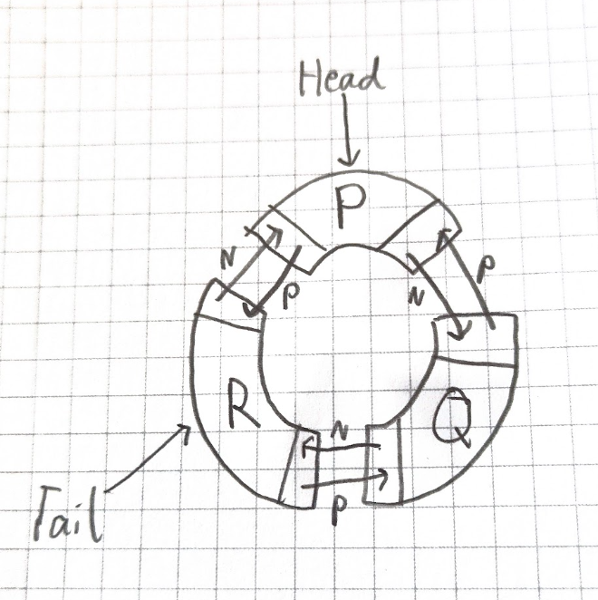

1. Draw a circular doubly linked list (CDLL) containing the letters P, Q, R. Clearly label the `Head` (pointing to P) and `Tail` (pointing to R) pointers, and show all `Prev` and `Next` pointers correctly, including the circular links between Head and Tail.

2. Complete the following table comparing the approximate time complexity (using Big O notation - O(1) or O(n)) and memory usage for basic operations on different data structures. Assume 'n' is the number of elements. For linked lists, assume deleting/inserting in the middle requires traversing to find the position, unless specified otherwise.
3.
| Operation | Array | SLL | DLL (with Tail Pointer) | CSLL | CDLL (with Head/Tail Pointers) | Memory Usage (Overhead per Node) |
|---|---|---|---|---|---|---|
| Access by Index | O(1) | O(n) | O(n) | O(n) | O(n) | --- |
| Search by Value | O(n) | O(n) | O(n) | O(n) | O(n) | --- |
| Insert at Head/Start | O(n) | O(1) | O(1) | O(1) | O(1) | --- |
| Insert at Tail/End | O(1) | O(n) | O(1) | O(1) | O(1) | --- |
| Insert in Middle | O(n) | O(n) | O(n) | O(n) | O(n) | --- |
| Delete at Head/Start | O(n) | O(1) | O(1) | O(1) | O(1) | --- |
| Delete at Tail/End | O(1) | O(n) | O(1) | O(n) | O(1) | --- |
| Delete in Middle | O(n) | O(n) | O(n) | O(n) | O(n) | --- |
| Memory Overhead (Extra per element beyond data) | None | 1 pointer | 2 pointers | 1 pointer | 2 pointers | N/A |

4. You are designing a system to manage a queue of print jobs arriving at a shared printer. Jobs arrive at one end and are processed from the other end. The number of jobs varies frequently. You need to efficiently add jobs to the end and remove jobs from the front. Which data structure (Array, SLL, DLL, CLL) would you choose to implement this queue and *why*? Justify your answer by referencing the advantages/disadvantages and performance characteristics of your chosen structure compared to others.

> Circular linked list where you only keep a pointer to the last node, since its next is the front of the queue. Adding a job means linking it in after the last node and making it the new last node, and removing a job means unlinking the node after the last one, so both are O(1). The list also grows and shrinks efficiently as the number of jobs changes. An array is worse because removing from the front shifts everything along, which is O(n). An SLL would need two pointers to do the same thing, and a DLL wastes memory on a prev pointer that is never used.
