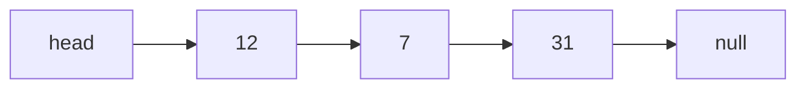

Every `.md` file in the `notes/` folder becomes a page. Folders are optional, but a note's first folder becomes its topic if you don't set one.

## Writing in the browser

Select **New note** in the sidebar (or **Edit** on any note). The editor has a formatting toolbar, live preview, and keyboard shortcuts (Ctrl+B, Ctrl+I, Ctrl+K and so on). Paste or drop screenshots straight into the text. Drafts save in your browser automatically, so closing the tab loses nothing.

Under the text, **Files** holds code and data that belong to the note: write Python or JavaScript and run it right there, or upload a CSV and read it from Python. When you're done, **Finish note** asks for the date, topics and tags, then either downloads everything as one zip or, in Chrome and Edge, saves it straight into your repo folder. Commit and push to publish.

## Code files

A note's files live in `assets/<note file name>/` next to it, alongside its images. They share the note's date, topics and tags, their contents are searchable, and they appear under **Code** in the sidebar filters (try `lang:python` in search). Python and JavaScript files and code blocks get a **Run** button; Python runs in the browser with Pyodide, including numpy, pandas and matplotlib.

If Python code has `import os`, it runs on a fresh copy of the note's files, and any file it creates, changes or deletes shows up in **Files** afterwards. In the editor those changes are saved with the note; on a published note they last until you reload the page.

## The note header

Put this at the very top of a note. Every line is optional.

```yaml
---
title: Arrays and linked lists   # default: the file name
date: 2026-09-24                 # default: date in the file name, then first git commit
topics: [Data structures]        # default: the folder name
tags: [arrays, complexity]
description: One line shown in lists.
draft: true                      # hides the note from the site
---
```

In VS Code, type `note` and pick the snippet to insert this.

## Linking notes

Write `[[Arrays and linked lists]]` to link by title: [[Arrays and linked lists]]. Use `[[Arrays and linked lists|a label]]` for different link text. Normal relative links such as `[text](example-arrays-and-linked-lists.md)` also work. Linked notes show a "Linked from" list at the bottom.

## Callouts

> [!TIP]
> Start a quote with `[!TIP]`, `[!NOTE]`, `[!WARNING]`, `[!DEFINITION]`, `[!EXAMPLE]` or `[!IMPORTANT]`.

> [!DEFINITION] Big O notation
> Describes how running time grows with input size $n$, ignoring constants.

> [!QUESTION]- Add a minus sign to hide the body. Click to reveal.
> Useful for self-testing: put the question in the title and the answer in the body.

## Maths

Inline with single dollars: $T(n) = 2T(n/2) + O(n)$. Display with double dollars:

$$
\sum_{i=1}^{n} i = \frac{n(n+1)}{2}
$$

## Diagrams



## Tables and tasks

| Operation        | Array | Linked list |
|------------------|-------|-------------|
| Access by index  | O(1)  | O(n)        |
| Insert at front  | O(n)  | O(1)        |

- [x] Push a note
- [ ] Write the next one

## Colours

Pick a colour in the toolbar (the colour square, or type a hex code next to it), choose **what to colour** from the menu, then press **Text**, **Fill** or **Border**. Pressing a second button on the same text adds to it instead of wrapping it again.

| You write | You get |
|---|---|
| `[red words]{color=#e03131}` | [red words]{color=#e03131} |
| `[highlighted]{bg=#ffe066}` | [highlighted]{bg=#ffe066} |
| `[short form]{#1c7ed6}` | [short form]{#1c7ed6} |
| `[all three]{color=#ffffff bg=#c92a2a border=#5c0d0d}` | [all three]{color=#ffffff bg=#c92a2a border=#5c0d0d} |

- **Settings:** `color` (or `c`, `text`), `bg` (or `background`, `highlight`) and `border`. Values are hex codes (`#rgb`, `#rrggbb`, `#rrggbbaa`) or colour names like `teal`.
- If you only set `bg`, the text colour is picked automatically so it stays readable in light and dark mode.
- **A whole line, heading or list item:** put the braces at the end, e.g. `## Key idea {color=#7048e8}` or `- Revise this {bg=#fff3bf}`.

### Table colours

Put `{...}` inside a cell to colour that cell, `{row ...}` to colour the whole row, and `{col ...}` in a header cell to colour the whole column.

```markdown
| Station {col bg=#e7f5ff} | Status | Notes |
|---|---|---|
| A | {bg=#d3f9d8} Done | [check again]{color=#e8590c} |
| B {row bg=#ffe3e3} | Not started | |
```

| Station {col bg=#e7f5ff} | Status | Notes |
|---|---|---|
| A | {bg=#d3f9d8} Done | [check again]{color=#e8590c} |
| B {row bg=#ffe3e3} | Not started | |

### Coloured boxes

```markdown
::: {bg=#f3f0ff border=#9775fa}
Anything inside, **including** lists and maths like $x^2$.
:::
```

::: {bg=#f3f0ff border=#9775fa}
Anything inside, **including** lists and maths like $x^2$.
:::

## Images

Paste an image into a note in the browser editor or in VS Code. With the included settings it is saved to `assets/<note name>/` next to the note, and the link just works here. Click any image to enlarge it.

## Search

Press <kbd>/</kbd> anywhere to search. `tag:arrays` and `topic:data` narrow by tag or topic; matches are highlighted when you open a note.
